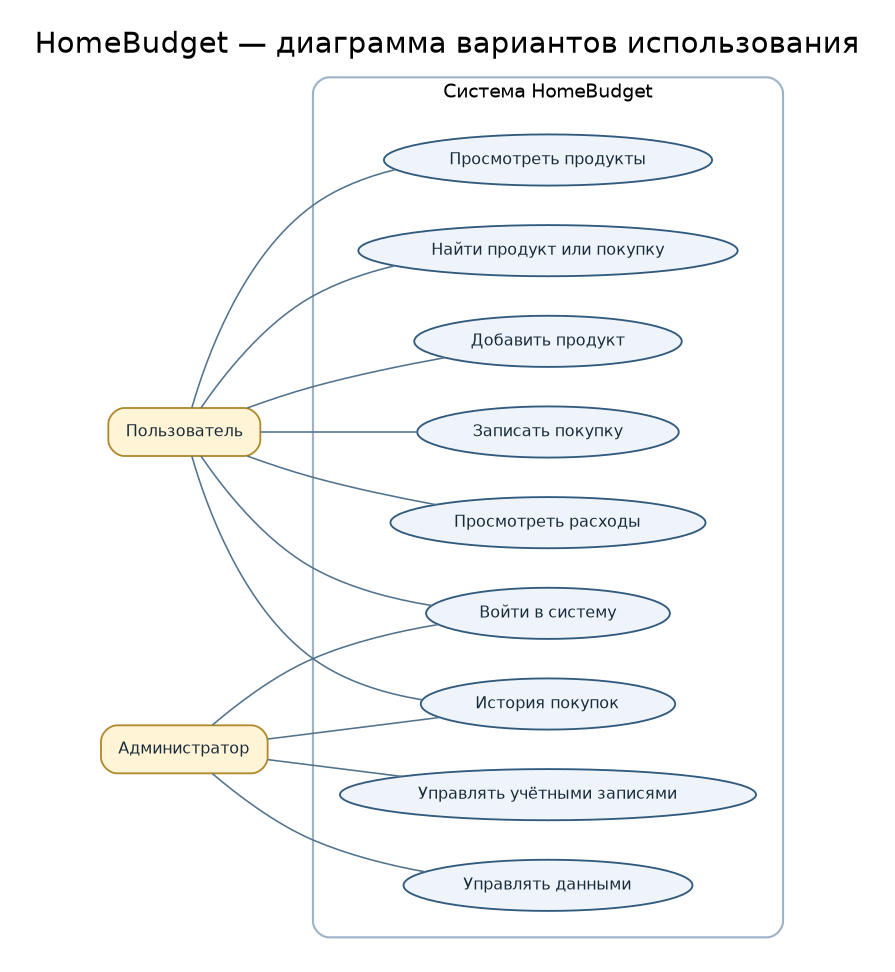
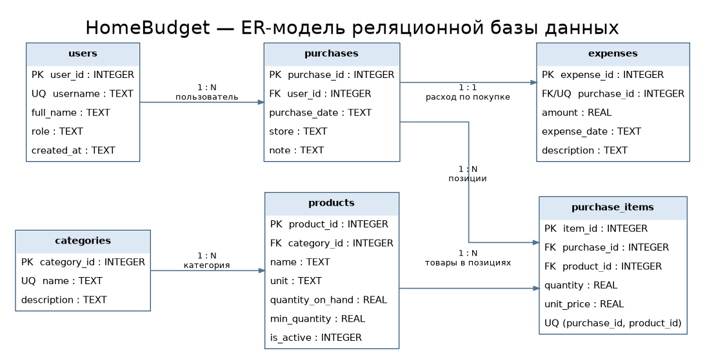

# HomeBudget — учёт домашнего хозяйства

**HomeBudget** — учебный консольный проект для учёта продуктов, покупок и расходов домашнего хозяйства. Он продолжает предметную область лабораторной работы №1 и демонстрирует документирование проекта (лабораторная №2) и проектирование базы данных (лабораторная №3).

## Цели проекта

- хранить список продуктов, категории и текущие остатки;
- регистрировать покупки и их позиции;
- автоматически учитывать расход по каждой покупке;
- просматривать историю покупок и общую сумму расходов;
- сохранять информацию в локальной базе SQLite;
- описывать структуру и функциональность проекта с помощью Markdown и PlantUML.

## Технологии

| Инструмент | Назначение |
|---|---|
| Python 3.10+ | Консольная программа и слой доступа к данным |
| SQLite | Локальная реляционная база данных |
| Git | История версий проекта |
| GitHub | Удалённый репозиторий и совместная работа |
| Markdown | Документация проекта в `README.md` |
| PlantUML | Текстовое описание диаграмм |

## Быстрый запуск

Установите Python 3.10 или новее и Git. Дополнительные Python-пакеты не требуются: используется стандартная библиотека.

В корневой папке проекта выполните:

```bash
python src/main.py
```

При первом запуске приложение создаёт таблицы SQLite и добавляет демонстрационные записи. База находится в `database/homebudget.db`.

### Основные команды

```bash
python src/main.py products     # продукты и текущие остатки
python src/main.py purchases    # история покупок и суммы
python src/main.py expenses     # список расходов и итоговая сумма
python src/main.py init         # создать структуру БД и добавить демоданные
```

Добавить продукт:

```bash
python src/main.py add-product --name "Бананы" --category "Овощи и фрукты" --unit "кг" --quantity 1 --min-quantity 0.5
```

Записать покупку. Формат позиции: `ID_продукта:количество:цена_за_единицу`. Аргумент `--item` можно указывать несколько раз:

```bash
python src/main.py add-purchase --store "Магнит" --item 1:2:89.90 --item 2:1.2:119.50 --note "Покупка на неделю"
```

## Структура проекта

```text
HomeBudget_Lab2_3/
├── README.md
├── .gitignore
├── requirements.txt
├── src/
│   ├── main.py              # консольный интерфейс
│   └── database.py          # слой доступа к SQLite
├── database/
│   ├── schema.sql           # создание таблиц и ограничений
│   ├── seed.sql             # демонстрационные записи
│   └── homebudget.db        # готовая учебная база данных
├── diagrams/
│   ├── use_case.puml        # Use Case, исходник PlantUML
│   ├── use_case.png         # изображение диаграммы
│   ├── er_diagram.puml      # ER-модель, исходник PlantUML
│   └── er_diagram.png       # изображение ER-модели
├── tests/
│   └── test_database.py     # автоматические проверки
└── docs/
    └── publication_guide.md # памятка по GitHub и защите
```

## Диаграмма вариантов использования

Диаграмма описывает основные действия пользователя и администратора. Редактируемый исходник: [`diagrams/use_case.puml`](diagrams/use_case.puml).



## Модель данных (лабораторная работа №3)

| Таблица | Назначение | Ключевые связи |
|---|---|---|
| `users` | Пользователи и роли | `users` 1:N `purchases` |
| `categories` | Категории продуктов | `categories` 1:N `products` |
| `products` | Продукты и остатки | участвует в `purchase_items` |
| `purchases` | Заголовок покупки | связан с пользователем, позициями и расходом |
| `purchase_items` | Состав покупки | связующая таблица для связи M:N покупок и продуктов |
| `expenses` | Сумма расхода по покупке | `purchase_id` — внешний и уникальный ключ, связь 1:1 с `purchases` |



Подробный SQL находится в [`database/schema.sql`](database/schema.sql), тестовые данные — в [`database/seed.sql`](database/seed.sql). Исходник ER-диаграммы: [`diagrams/er_diagram.puml`](diagrams/er_diagram.puml).

## Проверка проекта

Запустить автоматические тесты можно командой:

```bash
python -m unittest discover -s tests -v
```

Тесты проверяют загрузку демонстрационных данных, запись расхода при регистрации покупки и откат транзакции при ошибочном ID продукта.

## Работа с Git и публикация на GitHub

Локальный репозиторий содержит историю коммитов. Чтобы опубликовать проект в своём GitHub-аккаунте:

1. Создайте на GitHub **пустой** репозиторий с именем `HomeBudget` (не добавляйте при создании README, лицензию или `.gitignore`).
2. В корневой папке проекта выполните команды, заменив `YOUR_USERNAME` на имя своего аккаунта:

   ```bash
   git remote add origin https://github.com/YOUR_USERNAME/HomeBudget.git
   git push -u origin main
   ```
3. Если Git сообщает, что `origin` уже существует, проверьте адрес командой `git remote -v`; при необходимости замените его командой `git remote set-url origin https://github.com/YOUR_USERNAME/HomeBudget.git`.
4. Перед созданием собственных коммитов настройте реальные имя и почту Git:

   ```bash
   git config user.name "Имя Фамилия"
   git config user.email "почта, подтверждённая в GitHub"
   ```

> Удалённый репозиторий не создаётся автоматически: для входа и публикации требуется ваш аккаунт GitHub. Локальная часть проекта и коммиты подготовлены.

## Документация

- [Памятка по публикации и защите](docs/publication_guide.md)
- [Краткий сценарий защиты](docs/defense_script.md)
- Отчёты Word и PDF: `docs/Отчет_ЛР2_Мельник.*`, `docs/Отчет_ЛР3_Мельник.*`
- [Git](https://git-scm.com/doc)
- [GitHub Docs](https://docs.github.com/)
- [PlantUML](https://plantuml.com/)
- [Документация SQLite](https://www.sqlite.org/docs.html)
